# MaldiDeepKit

[](https://github.com/EttoreRocchi/MaldiDeepKit/actions/workflows/ci.yml)
[](https://codecov.io/github/EttoreRocchi/MaldiDeepKit)
[](https://maldideepkit.readthedocs.io/)

[](https://pypi.org/project/maldideepkit/)
[](https://pypi.org/project/maldideepkit/)
[](https://github.com/EttoreRocchi/MaldiDeepKit/blob/main/LICENSE)

<p align="center">
  <picture>
    <source media="(prefers-color-scheme: dark)" srcset="https://raw.githubusercontent.com/EttoreRocchi/MaldiDeepKit/main/docs/maldideepkit_logo_dark.png">
    
  </picture>
</p>

<p align="center">
  <strong>Deep-learning classifiers for binned MALDI-TOF spectra</strong>
</p>

<p align="center">
  
</p>

<p align="center">
  <a href="#installation">Installation</a> •
  <a href="#features">Features</a> •
  <a href="#quick-start">Quick start</a> •
  <a href="https://maldideepkit.readthedocs.io/">Documentation</a> •
  <a href="#tutorials">Tutorials</a> •
  <a href="#maldisuite-ecosystem">MaldiSuite</a> •
  <a href="#contributing">Contributing</a> •
  <a href="#citation">Citation</a> •
  <a href="#license">License</a>
</p>

MaldiDeepKit provides four PyTorch backbones (MLP, 1-D CNN, 1-D ResNet, and 1-D Vision Transformer), a dual-branch classifier for a spectrum plus side features, a self-training classifier for partly labelled data, and a self-supervised encoder that pre-trains the backbones on unlabelled spectra. All of them share one scikit-learn estimator API, with defaults set for 6000-bin MALDI-TOF spectra. It is part of the **MaldiSuite** ecosystem: it can be used on its own, or together with [MaldiAMRKit](https://github.com/EttoreRocchi/MaldiAMRKit) and [MaldiBatchKit](https://github.com/EttoreRocchi/MaldiBatchKit).

## Installation

```bash
pip install maldideepkit
```

`maldiamrkit` is a core dependency and is installed automatically (MaldiDeepKit duck-types on the `MaldiSet` data model and reuses `maldiamrkit.alignment.Warping` for leak-safe spectral warping).

To enable the Laplace-approximation estimator in `maldideepkit.uncertainty`, install the optional `uncertainty` extra (pulls in [`laplace-torch`](https://github.com/aleximmer/Laplace)):

```bash
pip install "maldideepkit[uncertainty]"
```

Monte Carlo Dropout and split conformal prediction work without any extra.

The `smiles_to_fingerprint` helper used in `MaldiDualBranchClassifier` workflows requires RDKit, available via the `rdkit` extra:

```bash
pip install "maldideepkit[rdkit]"
```

### Install the full MaldiSuite

To install MaldiDeepKit together with [MaldiAMRKit](https://github.com/EttoreRocchi/MaldiAMRKit) and [MaldiBatchKit](https://github.com/EttoreRocchi/MaldiBatchKit) at compatible versions, install the [`maldisuite`](https://pypi.org/project/maldisuite/) meta-package:

```bash
pip install maldisuite
```

Visit the **MaldiSuite** landing page at <https://ettorerocchi.github.io/MaldiSuite/>.

### Development installation

```bash
git clone https://github.com/EttoreRocchi/MaldiDeepKit.git
cd MaldiDeepKit
pip install -e ".[dev]"
pre-commit install
```

See [`CONTRIBUTING.md`](https://github.com/EttoreRocchi/MaldiDeepKit/blob/main/CONTRIBUTING.md) for coding conventions, testing, and PR guidelines.

## Features

- **Unified scikit-learn API** (`BaseEstimator` + `ClassifierMixin`) for every classifier: `fit`, `predict`, `predict_proba`, `score`, `get_params`, and `set_params`, so each one works in `Pipeline`, `cross_val_score`, and `GridSearchCV`.
- **Four PyTorch architectures** sharing the same base class and parameters:
  - `MaldiMLPClassifier` - MLP with optional sigmoid-gated attention on the first hidden layer.
  - `MaldiCNNClassifier` - 1-D Conv1D + BatchNorm + ReLU + MaxPool blocks for local pattern learning.
  - `MaldiResNetClassifier` - 1-D ResNet-18-style residual blocks for a deeper convolutional backbone.
  - `MaldiTransformerClassifier` - 1-D Vision Transformer with global self-attention, pre-norm, LayerScale, and stochastic depth.
- **MALDI-TOF defaults**: kernel sizes, depths, patch widths, and warmup / cosine-annealing schedules are tuned for 6000-bin spectra in the 2000-20000 Da range.
- **Auto-scaling for non-default layouts**: the four architectures and the dual-branch classifier have a `from_spectrum(bin_width, input_dim, **overrides)` factory, which sets `input_dim` and scales the conv kernels of the CNN and the ResNet to the bin width. See the [Spectrum scaling guide](https://maldideepkit.readthedocs.io/en/stable/spectrum_scaling.html).
- **Training recipes**: AdamW when `weight_decay > 0`, gradient clipping, linear warmup and cosine annealing, focal loss, label smoothing, mixed precision (AMP), Stochastic Weight Averaging, Sharpness-Aware Minimization, post-hoc threshold tuning, and temperature scaling, all set through classifier parameters.
- **Leak-safe spectral warping**: pass any sklearn-style transformer (such as [`maldiamrkit.alignment.Warping`](https://github.com/EttoreRocchi/MaldiAMRKit)) as `warping=`; it is fitted on the training split only, then applied to both splits during training and to new spectra at `predict` time, *before* per-feature standardisation.
- **MaldiSet integration**: pass a `maldiamrkit.MaldiSet` directly to `fit` / `predict`; MaldiDeepKit reads its DataFrame-like `.X` attribute.
- **Persistence**: `save()` writes a state-dict `.pt` plus a hyperparameter `.json` (and a `.warper.pkl` when a warper was fitted); `load()` raises on a class mismatch, and `predict` on a wrong number of bins.
- **Uncertainty quantification**: the `maldideepkit.uncertainty` subpackage has three drop-in estimators sharing one `predict_with_uncertainty` interface: `MCDropoutEstimator` (Monte Carlo Dropout with epistemic / aleatoric decomposition), `LaplaceEstimator` (last-layer or full-network Laplace through the optional `laplace-torch` dependency), and `ConformalPredictor` (split conformal prediction with the LAC non-conformity score).
- **Extensible**: choose the optimiser, scheduler, loss, and callbacks of every architecture and of the dual-branch classifier; custom backbones and pre-text tasks work wherever a built-in one does (see [Choosing the training components](#choosing-the-training-components)).
- **Self-supervised pre-training**: `MaldiSpectrumEncoder` pre-trains any of the four backbones on unlabelled spectra (masked reconstruction, intensity-weighted bin shuffling, both combined, or contrastive views, with an optional semi-supervised auxiliary head); classifiers start their trunk from it with `init_from=` and can train only the final layer first with `freeze_trunk_epochs=`. See [Self-supervised pre-training](#self-supervised-pre-training).
- **GPU or CPU**: with the default `device="auto"`, every classifier trains on a CUDA GPU when one is available and on CPU otherwise.

## Documentation

Full documentation is available at [maldideepkit.readthedocs.io](https://maldideepkit.readthedocs.io/).

## Quick start

### Fit a classifier

Every MaldiDeepKit classifier exposes the standard scikit-learn estimator API. Swapping architectures is a one-line change:

```python
import numpy as np
from maldideepkit import MaldiMLPClassifier

rng = np.random.default_rng(0)
X = rng.standard_normal((200, 6000)).astype("float32")  # 200 binned spectra
y = rng.integers(0, 2, size=200)

clf = MaldiMLPClassifier(random_state=0)
clf.fit(X, y)

proba = clf.predict_proba(X)
preds = clf.predict(X)
acc = clf.score(X, y)

# Inspect attention weights (MLP only)
weights = clf.get_attention_weights(X[:10])  # (10, hidden_dim)
```

### Inside a scikit-learn `Pipeline`

```python
from sklearn.model_selection import StratifiedKFold, cross_val_score
from sklearn.pipeline import Pipeline
from sklearn.preprocessing import StandardScaler
from maldideepkit import MaldiCNNClassifier

pipe = Pipeline([
    ("scaler", StandardScaler()),
    ("clf", MaldiCNNClassifier(random_state=0)),
])

cv = StratifiedKFold(n_splits=5, shuffle=True, random_state=0)
scores = cross_val_score(pipe, X, y, cv=cv, scoring="accuracy")
print(f"CV accuracy: {scores.mean():.3f} ± {scores.std():.3f}")
```

### MaldiSet integration

A [MaldiAMRKit](https://github.com/EttoreRocchi/MaldiAMRKit) `MaldiSet` can be passed directly:

```python
from maldiamrkit import MaldiSet
from maldideepkit import MaldiCNNClassifier

ds = MaldiSet.from_directory(
    "spectra/", "metadata.csv",
    aggregate_by={"antibiotics": "Ciprofloxacin"},
    n_jobs=-1,
)
clf = MaldiCNNClassifier(random_state=0).fit(ds, ds.y.squeeze())
preds = clf.predict(ds)
```

### Auto-scaling for custom layouts

When the spectrum layout deviates from the reference 6000-bin / 3 Da default, `from_spectrum` rescales the conv kernels:

```python
from maldideepkit import MaldiCNNClassifier, MaldiTransformerClassifier

# Reference layout (kernel_size=7, patch_size=4)
cnn = MaldiCNNClassifier.from_spectrum(bin_width=3, input_dim=6000)

# Wider bins -> smaller kernel
cnn_coarse = MaldiCNNClassifier.from_spectrum(bin_width=6, input_dim=3000)

# Transformer is scale-agnostic; only input_dim is recorded
tr = MaldiTransformerClassifier.from_spectrum(bin_width=1, input_dim=18000)
```

See the [Spectrum scaling guide](https://maldideepkit.readthedocs.io/en/stable/spectrum_scaling.html) for how each parameter is scaled.

### Save and load

```python
clf.save("my_model")
# -> my_model.pt, my_model.json, my_model.warper.pkl (if warping was used)
restored = MaldiCNNClassifier.load("my_model")
```

For more examples covering training recipes, calibration, and attention inspection, see the [Quickstart guide](https://maldideepkit.readthedocs.io/en/stable/quickstart.html) and, for ensembles, the [API reference](https://maldideepkit.readthedocs.io/en/stable/api/index.html).

## Algorithms

| Classifier | Backbone | Typical use case |
|---|---|---|
| `MaldiMLPClassifier` | MLP + optional sigmoid-gated attention | Fast baseline with inspectable attention gates |
| `MaldiCNNClassifier` | 1-D Conv1D + BatchNorm + ReLU + MaxPool blocks | Local pattern learning from binned spectra |
| `MaldiResNetClassifier` | 1-D ResNet-18-style residual blocks | Deeper convolutional backbone |
| `MaldiTransformerClassifier` | 1-D Vision Transformer (LayerScale, stochastic depth) | Long-range peak combinations through global self-attention |
| `MaldiDualBranchClassifier` | Spectrum branch + per-row side-feature branch + fused head | Multi-modal: condition on an antibiotic fingerprint, instrument ID, patient feature, ... |

All five inherit from `BaseSpectralClassifier` (or its dual-input subclass `BaseDualSpectralClassifier`) and share the same parameters for optimisation, device placement, early stopping, calibration, and persistence.

### Semi-supervised wrapper

| Class | Purpose |
|---|---|
| `MaldiSelfTrainingClassifier` | Iterative pseudo-labelling on a labelled seed plus an unlabelled pool (rows marked `-1` by default). Wraps any classifier (defaults to `MaldiMLPClassifier`); follows the `sklearn.semi_supervised.SelfTrainingClassifier` API. |

### Self-supervised encoder

| Class | Purpose |
|---|---|
| `MaldiSpectrumEncoder` | Self-supervised pre-training of a backbone on unlabelled (or partially labelled) spectra; scikit-learn transformer returning `(n_samples, feature_dim_)` embeddings, with `save` / `load`. Its checkpoint initialises a classifier through `init_from=` (see [Self-supervised pre-training](#self-supervised-pre-training)). |

### Shared training parameters

| Feature | Parameter | Notes |
|---|---|---|
| Decoupled weight decay | `weight_decay` | Switches Adam to AdamW when `> 0`. Default `0` (MLP/CNN), `1e-4` (ResNet), `0.05` (Transformer). |
| Gradient clipping | `grad_clip_norm` | `clip_grad_norm_` before every step. Default on (`1.0`) for the deep models. |
| Warmup + cosine annealing | `warmup_epochs` | Epochs of linear warmup before the cosine schedule (`scheduler="cosine"`, the default). Default `5` (deep models), `0` (MLP/CNN). |
| Stochastic depth (Transformer) | `drop_path_rate` | Linearly ramped across blocks. Default `0.1`. |
| LayerScale (Transformer) | `layerscale_init` | Per-channel residual scaling initialised near zero (crucial on small cohorts). |
| Focal loss | `loss="focal"` + `focal_gamma` | For imbalanced binary problems. |
| Label smoothing | `label_smoothing` | Passed to both cross-entropy and focal paths. |
| Mixed precision | `use_amp` + `amp_dtype` | Autocast on a GPU; `amp_dtype` is `"float16"` (default, with a `GradScaler`), `"bfloat16"`, or `"auto"` (`bfloat16` when the GPU supports it). |
| Stochastic Weight Averaging | `swa_start_epoch` | `AveragedModel` replaces best-val at end of fit. |
| Threshold tuning | `tune_threshold` | Binary only; sweeps balanced-accuracy / F1 / Youden on val. |
| Temperature scaling | `calibrate_temperature` | One-parameter LBFGS calibration on val logits. |
| Sharpness-Aware Minimization | `use_sam` + `sam_rho` | Two-pass training, ~2× compute. |
| Spectral warping | `warping` | Any `Warping`-like scikit-learn transformer; fitted on train only, applied before standardisation. |
| Per-sample weighting | `sample_weight` (`fit`) | sklearn-style weighted-mean loss; composes with `class_weight` and flows into early stopping, threshold tuning, and temperature scaling. |
| Warm-start / resume | `warm_start` (`fit`) | Reuse the existing fitted module as the training start point (continual, federated, or fine-tuning). |
| Self-supervised initialisation | `init_from` | Encoder checkpoint path or fitted `MaldiSpectrumEncoder`; copies the trunk and inherits the encoder's fitted preprocessing. |
| Linear probing then fine-tuning | `freeze_trunk_epochs` | Train only the final layer for the first N epochs, then unfreeze the trunk (LP-FT). Default `0`. |
| Compiled training | `torch_compile` | Train through `torch.compile` (default `False`); the fitted module, checkpoints, `init_from`, and inference stay uncompiled. Pays off on long GPU runs. |

### Utilities

`maldideepkit.utils` exposes:

- **`find_lr(clf, X, y)`** - learning-rate finder.
- **`tune_threshold` / `fit_temperature`** - post-hoc calibrators usable standalone.
- **`FocalLoss`, `SAMOptimizer`** - loss / optimiser building blocks for custom training loops. Composable `nn.Module` primitives (`DropPath`, `PatchEmbed1D`, the full backbones) live under `maldideepkit.blocks`.
- **`SpectralEnsemble(classifiers)`** - averages the `predict_proba` of several classifiers (fitted members, or instances and names that `fit` trains); a scikit-learn estimator with `save` / `load`.

## Self-supervised pre-training

`MaldiSpectrumEncoder` (from `maldideepkit` or `maldideepkit.pretraining`) pre-trains any of the four backbones on unlabelled spectra with a self-supervised pre-text task: `pretext="mae"` (masked-bin reconstruction, the default), `"shuffle"` (detect bins swapped between spectra, sampled proportionally to intensity), `"shuffle+mae"`, or `"contrastive"` (NT-Xent on two augmented views). With `aux_lambda > 0` an auxiliary head is also trained on the labelled rows of a partial `y` (classification or regression; unlabelled rows marked `-1` or `NaN`). A classifier then starts its trunk (every layer except the final one) from the encoder with `init_from=` and is fine-tuned on the labelled data:

```python
import numpy as np
from sklearn.base import clone
from maldideepkit import MaldiCNNClassifier, MaldiSpectrumEncoder

rng = np.random.default_rng(0)
X_pool = np.abs(rng.standard_normal((2000, 6000))).astype("float32")  # unlabeled spectra
X = np.abs(rng.standard_normal((200, 6000))).astype("float32")        # labeled spectra
y = rng.integers(0, 2, size=200)

# 1. Pre-train the backbone of the classifier you will fine-tune: the
#    template fixes both the architecture and the preprocessing.
template = MaldiCNNClassifier(random_state=0)
encoder = MaldiSpectrumEncoder(backbone=template, pretext="mae", random_state=0)
encoder.fit(X_pool)                 # no labels needed
encoder.save("cnn_encoder")         # -> cnn_encoder.pt, cnn_encoder.json
Z = encoder.transform(X)            # (200, encoder.feature_dim_) embeddings

# 2. Fine-tune: trunk from the encoder, fresh final layer, encoder preprocessing.
clf = clone(template).set_params(init_from="cnn_encoder").fit(X, y)

# 3. LP-FT: only the final layer for 10 epochs, then the whole network.
lpft = clone(template).set_params(init_from="cnn_encoder", freeze_trunk_epochs=10)
lpft.fit(X, y)
print(lpft.trunk_unfroze_, lpft.best_epoch_phase_)  # unfreeze reached? phase of the kept weights
```

- **Preprocessing comes from the template**: the encoder fits the template's `standardize`, `input_transform`, and `warping` on the pool, and a classifier with `init_from` reuses that fitted state (a mismatch raises `ValueError`).
- **Linear probing first**: `freeze_trunk_epochs=k` trains only the final layer for `k` epochs, then the whole network (LP-FT); `trunk_unfroze_` and `best_epoch_phase_` report what happened.
- **Clone-safe**: give `init_from` a checkpoint path in `GridSearchCV`, `cross_val_score`, or `MaldiSelfTrainingClassifier`; a fitted encoder instance is shared by reference across clones.
- **Dual-branch**: `MaldiDualBranchClassifier` takes `init_from` and `freeze_trunk_epochs` for its spectral branch.
- **Pre-text tasks**: `pretext=` takes a name or a `Pretext` instance (`MAEPretext`, `ShufflePretext`, `ShuffleMAEPretext`, `ContrastivePretext`, or your own subclass); `register_pretext` adds a name, and a task with `uses_target = True` receives the `y` given to `fit`.
- **Contrastive views**: `augment=SpectrumAugment(...)` replaces the default views of `pretext="contrastive"`.
- **GPU throughput**: `data_device="auto"` keeps the pool on the GPU when it fits, and `torch_compile=True` compiles the model for `fit`.
- **Custom backbones**: a `BaseSpectralClassifier` subclass works wherever a built-in one does, and `register_backbone` gives it a name.

See the [Pre-training API reference](https://maldideepkit.readthedocs.io/en/stable/api/pretraining.html) for the details of each point, a custom pre-text example, the auxiliary head, and the checkpoint format.

## Choosing the training components

The four architectures and the dual-branch classifier take these parameters, and `MaldiSpectrumEncoder` takes all of them except `loss` (its loss is the pre-text task); with self-training, set them on its base estimator. The defaults are Adam (AdamW when `weight_decay > 0`), the warmup plus cosine schedule, and cross-entropy.

| Parameter | Accepts |
|---|---|
| `optimizer` | A `torch.optim` name (`"sgd"`), a class, or a factory such as `functools.partial(torch.optim.SGD, momentum=0.9)`. |
| `scheduler` | `"cosine"`, `"constant"`, or a class or factory called with the optimiser; stepped once per epoch after the warmup. |
| `loss` | `"cross_entropy"`, `"focal"`, or an `nn.Module` or function returning one value per row or a scalar. |
| `callbacks` | `Callback` objects with the hooks `on_train_start`, `on_epoch_start`, `on_step_end`, `on_epoch_end`, and `on_train_end`. |

```python
from functools import partial

import torch
from maldideepkit import Callback, MaldiCNNClassifier


class ValLoss(Callback):
    def __init__(self):
        self.values = []

    def on_epoch_end(self, model, epoch, logs):
        self.values.append(logs["val_loss"])


clf = MaldiCNNClassifier(
    optimizer=partial(torch.optim.SGD, momentum=0.9),
    scheduler=partial(torch.optim.lr_scheduler.StepLR, step_size=10, gamma=0.5),
    loss=torch.nn.CrossEntropyLoss(reduction="none"),
    callbacks=[ValLoss()],
).fit(X_train, y_train)
Z = clf.get_embeddings(X_test)  # (n_samples, feature_dim), as encoder.transform
```

`save` stores a class, a function, or a `functools.partial` by import path; any other object is rebuilt at `load` from its class and the attributes named after its constructor arguments. A lambda, or a function or class defined inside a function, cannot be saved: clear it first, for example with `set_params(optimizer=None)`. A class defined in a script or notebook is stored under `__main__`, so define it again before loading (or keep it in an importable module).

With the default `trusted=False`, `load` imports no new module: every class named by the checkpoint must come from MaldiDeepKit or from a module you have already imported. On top of that, an object given as `optimizer`, `scheduler`, `loss` or `callbacks` must be a torch module, optimiser or scheduler, or a `Callback`, and a function must be defined in MaldiDeepKit or in `torch.nn.functional` (a few functions exposed there, such as `F.gelu`, are defined elsewhere). Anything else needs `load(path, trusted=True)`. `init_from=<path>` always uses the default: for a trusted checkpoint, pass `MaldiSpectrumEncoder.load(path, trusted=True)`. A `.warper.pkl` is a pickle, read whatever `trusted` is: load checkpoints with a warper only from trusted sources.

`get_embeddings`, `sample_weight`, and `save` / `load` work the same way across the architectures, the dual-branch classifier, and self-training, and `from_spectrum` across the architectures and the dual-branch classifier (a custom `BaseSpectralClassifier` subclass inherits them).

## Tutorials

For more detailed examples, see the notebooks:

- [Quick start](https://github.com/EttoreRocchi/MaldiDeepKit/blob/main/notebooks/01_quick_start.ipynb) - Fit a `MaldiMLPClassifier` and explore the sklearn-compatible API.
- [Model comparison](https://github.com/EttoreRocchi/MaldiDeepKit/blob/main/notebooks/02_model_comparison.ipynb) - Train all four classifiers on the same dataset and compare AUROC.
- [Attention interpretation](https://github.com/EttoreRocchi/MaldiDeepKit/blob/main/notebooks/03_attention_interpretation.ipynb) - Visualise the sigmoid-gated attention learned by `MaldiMLPClassifier`.
- [Cross-validation with augmentation](https://github.com/EttoreRocchi/MaldiDeepKit/blob/main/notebooks/04_full_pipeline.ipynb) - Cross-validate a CNN with on-the-fly `SpectrumAugment` augmentation, scored by AUROC on stratified folds.
- [Uncertainty quantification](https://github.com/EttoreRocchi/MaldiDeepKit/blob/main/notebooks/05_uncertainty.ipynb) - MC Dropout, split conformal prediction, and Laplace approximation on a fitted classifier; selective prediction curves.
- [Self-supervised pre-training](https://github.com/EttoreRocchi/MaldiDeepKit/blob/main/notebooks/06_pretraining.ipynb) - Pre-train an encoder on unlabelled spectra, fine-tune from it at a few label fractions, and extend it with custom pre-text tasks, backbones, and training components.

## MaldiSuite ecosystem

MaldiDeepKit is one of the three packages of the **MaldiSuite** ecosystem:

- **[MaldiAMRKit](https://github.com/EttoreRocchi/MaldiAMRKit)** - preprocessing, alignment, peak detection, differential analysis, and classical-ML evaluation for MALDI-TOF AMR workflows.
- **[MaldiBatchKit](https://github.com/EttoreRocchi/MaldiBatchKit)** - batch-effect correction and harmonisation for multi-centre / multi-instrument MALDI-TOF spectra.
- **MaldiDeepKit** (this package) - sklearn-compatible deep learning classifiers.

The three packages share the `MaldiSet` data model. Each can be used on its own, or combined with the others. Install the full suite with `pip install maldisuite`. Landing page: [MaldiSuite](<https://ettorerocchi.github.io/MaldiSuite/>).

## Requirements

MaldiDeepKit needs Python 3.10 or newer and PyTorch 2.3 or newer (full list in [`requirements.txt`](https://github.com/EttoreRocchi/MaldiDeepKit/blob/main/requirements.txt)). Every model trains on a CUDA GPU when one is available and on CPU otherwise.

## Contributing

Pull requests, bug reports, and feature ideas are welcome. See the [Contributing Guide](https://github.com/EttoreRocchi/MaldiDeepKit/blob/main/CONTRIBUTING.md) for how to get started.

## Citation

MaldiDeepKit is part of MaldiSuite, which is described in an Application Note currently under review at *Bioinformatics*. The full citation will be added here once the article is published.

Publications using MaldiSuite are listed on the [MaldiSuite website](https://ettorerocchi.github.io/MaldiSuite/#research).

## License

This project is licensed under the **MIT License**. See the [LICENSE](https://github.com/EttoreRocchi/MaldiDeepKit/blob/main/LICENSE) file for details.

## Acknowledgements

The architectures and training recipes bundled in MaldiDeepKit are 1-D adaptations of well-established networks. In particular:

> **ResNet** - He K, Zhang X, Ren S, Sun J (2016). *Deep Residual Learning for Image Recognition*. **CVPR**. [doi:10.1109/CVPR.2016.90](https://doi.org/10.1109/CVPR.2016.90)

> **Vision Transformer** - Dosovitskiy A, Beyer L, Kolesnikov A, *et al.* (2021). *An Image is Worth 16x16 Words: Transformers for Image Recognition at Scale*. **ICLR**. [arXiv:2010.11929](https://arxiv.org/abs/2010.11929)

> **LayerScale** - Touvron H, Cord M, Sablayrolles A, *et al.* (2021). *Going deeper with Image Transformers*. **ICCV**. [arXiv:2103.17239](https://arxiv.org/abs/2103.17239)

> **Stochastic Depth** - Huang G, Sun Y, Liu Z, Sedra D, Weinberger K (2016). *Deep Networks with Stochastic Depth*. **ECCV**. [arXiv:1603.09382](https://arxiv.org/abs/1603.09382)

> **Temperature Scaling** - Guo C, Pleiss G, Sun Y, Weinberger KQ (2017). *On Calibration of Modern Neural Networks*. **ICML**. [arXiv:1706.04599](https://arxiv.org/abs/1706.04599)

> **Sharpness-Aware Minimization** - Foret P, Kleiner A, Mobahi H, Neyshabur B (2021). *Sharpness-Aware Minimization for Efficiently Improving Generalization*. **ICLR**. [arXiv:2010.01412](https://arxiv.org/abs/2010.01412)
